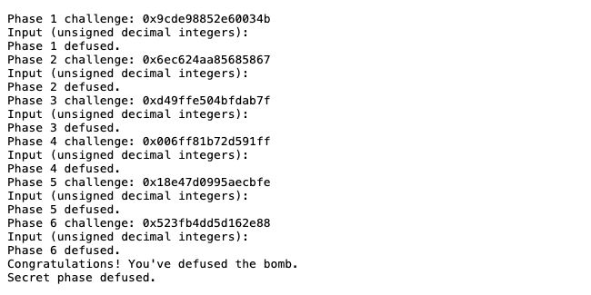
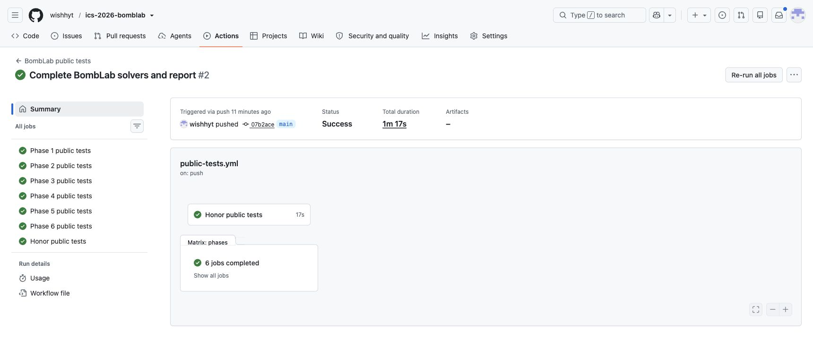

# BombLab 实验报告

## 环境与方法

实验在 Linux x86-64 上进行。先用 `objdump -d --no-show-raw-insn` 定位 `phase_01` 至 `phase_06`、各辅助函数及 `secret_gate`，再用 GDB 查看跳转表、链表节点和函数指针表。把汇编中的比较关系恢复成 C 计算后，使用个人 `bomb` 逐关验证。所有 32 位运算都用 `uint32_t` 表示，以保留模 \(2^{32}\) 回绕行为。

## 第 1 关：函数调用与返回值

`phase_01` 调用 `valid_u32_fields` 时传入数量 1，随后用 `sscanf` 读取一个整数。它把 `challenge` 传给 `p1_compute`，并用 `cmp %eax,-0x14(%rbp)` 对比计算结果和输入。

在 `p1_compute` 中，`shr $0x20,%rax`、`shr $0x10,%rdx` 分别提取高 32 位和右移 16 位后的部分。三个辅助函数中，`lea (%rdi,%rsi,2),%eax` 表示加上两倍第二参数，`lea (...,%rdi,4),%eax` 表示乘以 5。设 `lo=(uint32_t)c`、`mid=(uint32_t)(c>>16)`、`hi=(uint32_t)(c>>32)`，则：

```text
a = (lo + 2*mid) XOR 0x4aaa
b = 5*(hi - lo) + 0x6d61
答案 = (5*a + b) XOR 0xe3ba
```

## 第 2 关：数组与递推

`phase_02` 要求六个整数。第一项由 `shr $0x26,%rdx`、`and $0x1e,%edx` 和 `add $0xd,%edx` 得到。后续循环用 `rdx` 作数组下标，`ecx` 从 22 开始每轮增加 5，`shr %cl,%rdi` 提取 challenge 的不同位段。恢复出的关系为：

```text
v[0] = 13 + 2*((c >> 38) & 15)
v[i] = 5*(v[i-1] + i) - ((c >> (22 + 5*(i-1))) & 63), i=1..5
```

循环中 `cmp %esi,%eax` 逐项比较输入与期望值，因此六项必须全部符合递推。

## 第 3 关：跳转表

`phase_03` 读取两个整数。第一个必须是 `c & 7`；第二个由 `p3_dispatch` 计算。传入分支的数是 `x=(uint32_t)(c>>32) ^ (uint32_t)(c>>3)`。GDB 中查看 `0x405820` 处的八个指针，得到选择值到分支的实际对应关系：

| 选择值 | 第二个整数 |
| --- | --- |
| 0 | `5*x + 0x4cc9` |
| 1 | `(2*x) ^ 0x7ee8` |
| 2 | `(4*x) ^ 0x7546` |
| 3 | `5*x + 0x3638a` |
| 4 | `5*x + 0xe95c` |
| 5 | `3*x + 0x11f5` |
| 6 | `(x ^ 0xaa68) + (x >> 1)` |
| 7 | `(x ^ 0x2e98) + (x >> 1)` |

跳转表的顺序与函数在二进制中的排列不同，不能直接按地址顺序编号。

## 第 4 关：递归

`phase_04` 只检查一个整数，调用 `p4_walk` 时传入 `target=c&127`、区间 `[0,127]` 和 `salt=(uint32_t)(c>>7) ^ (uint32_t)(c>>32)`。`p4_walk` 每次取 `mid=lo+(hi-lo)/2`，按目标值向左或向右递归。`cmp %eax,%edi` 后的 `jb` 是无符号小于分支。

```text
target == mid:  (mid + 0xed) ^ salt
target < mid:   (5*walk(target,lo,mid-1,salt) ^ (mid+salt)) ^ 0x0f
target > mid:   (5*walk(target,mid+1,hi,salt) ^ (mid+salt)) ^ 0x1e
```

递归返回时，`lea (%rax,%rax,4),%eax` 把子问题结果乘以 5，再与本层的 `mid+salt` 及方向常量组合。

## 第 5 关：结构体与链表

`phase_05` 需要两个整数，调用 `p5_traverse`。`p5_heads` 是八个链表头指针；每个节点占 16 字节，偏移 0 是参与计算的数值，偏移 4 是标签，偏移 8 是下一节点指针。初始头节点取 `heads[c&7]`，额外移动次数是 `(c>>3)&3`。

计算先取 `acc=(uint32_t)(c>>6) ^ (uint32_t)(c>>32) ^ 0xa026`。包括头节点在内，每访问一个节点就更新 `acc=5*(acc+node.value)^node.tag`，同时记录该节点标签。最终输入依次是 `acc` 和最后一个节点的标签。节点值、标签和链接关系从个人炸弹的只读数据区读取，写在 `defuser.c` 的静态数组里。

## 第 6 关：函数指针表

`p6_dispatch` 在 `0x405e00` 处用函数指针表执行两次间接调用。第一次索引为 `c&7`，第二次索引为 `(c>>3)&7`；初值是 `x=(uint32_t)(c>>6) ^ (uint32_t)(c>>32)`。表的实际顺序为：右旋 7 位、op5、op5、左旋 3 位并异或、op5、op0、op3、op2。两次调用之间异或 `0xb1c2`，最后加 `0xa2c8`。

例如 op0 是 `(x+0x1d04)^(x>>1)`，op5 是 `((x>>5)^x)+0xd120`。`rol` 和 `ror` 按 32 位旋转实现；`xor $0xeb,%ah` 只改变第 8 至 15 位，等价于异或 `0xeb00`。

## Honor：入口门槛与三字段校验

`secret_gate` 先限制整行长度，然后 `secret_copy` 将整行复制到局部缓冲区。`cmpl $0x4e45504f,-0xb0(%rbp)` 检查偏移 32 处的四个字节，即 ASCII `OPEN`；真正的 `secret_phase` 从偏移 36 开始解析三个无符号整数。因此第七行由 32 个前缀字符、`OPEN` 和三个数字组成。

设 `c` 为 Honor challenge、`k` 为前六行生成的 context，`cfold=(uint32_t)c^(uint32_t)(c>>32)`、`kfold=(uint32_t)k^(uint32_t)(k>>32)`。`secret_mix` 中的 `rol $0x3,%eax`、加法和异或给出：

```text
f0 = (uint32_t)k & 3
mix = (rol32(cfold ^ kfold, 3) + 0xfa22) ^ 0x8a78
f1 = mix ^ (f0*0xfa22 ^ (uint32_t)(k>>16))
f2 = f1 ^ (kfold + f0 + 0x8a78 + (cfold>>3))
```

`solve_secret` 按此关系写出第七行，并检查 `snprintf` 是否超出缓冲区。正式六关不通过时，Honor 无法取得正确的 context，因此整套输入也做了联动测试。

## 验证记录

`make test` 的公开测试结果为正式关卡 `60/60`、Honor `10/10`。`tests/public.json` 的公开 seed 为 `0, 1, 7, 42, 99, 123, 2026, 65535, 987654321, 18446744073709551615`，以下记录使用列表之外的 seed `43`。先运行 `./defuser --seed 43` 生成前六行，再运行 `./defuser --secret --seed 43` 生成第七行，合并后输入 `./bomb --seed 43`。一次完整运行得到：

| 关卡 | challenge | 输入行 | 炸弹输出 |
| --- | --- | --- | --- |
| 1 | `0x9cde98852e60034b` | `93114130` | `Phase 1 defused.` |
| 2 | `0x6ec624aa85685867` | `17 69 339 1668 8323 41631` | `Phase 2 defused.` |
| 3 | `0xd49ffe504bfdab7f` | `7 1288735558` | `Phase 3 defused.` |
| 4 | `0x006ff81b72d591ff` | `402830526` | `Phase 4 defused.` |
| 5 | `0x18e47d0995aecbfe` | `333138733 2588` | `Phase 5 defused.` |
| 6 | `0x523fb4dd5d162e88` | `3359492882` | `Phase 6 defused.` |
| Honor | seed `43` 生成 | `AAAAAAAAAAAAAAAAAAAAAAAAAAAAAAAAOPEN0 2952151212 3352549582` | `Secret phase defused.` |

另用非公开 seed `2027`、`314159265` 完整运行，两次均显示六个 `Phase N defused.` 和 `Secret phase defused.`。为检查分支覆盖，还以固定随机数生成器产生 256 个额外 seed，全部通过完整炸弹及 Honor（`256/256`）。

运行结果截图：





## 资料与辅助工具

- 课程 [BombLab 实验文档](https://ics-26fall-fdu.github.io/labs/lab2-bomb-lab/) 和模板仓库 README。
- `objdump` 用于阅读反汇编；GDB 用于查看静态表内容；GCC、`public_test.py` 和个人 `bomb` 用于验证。
